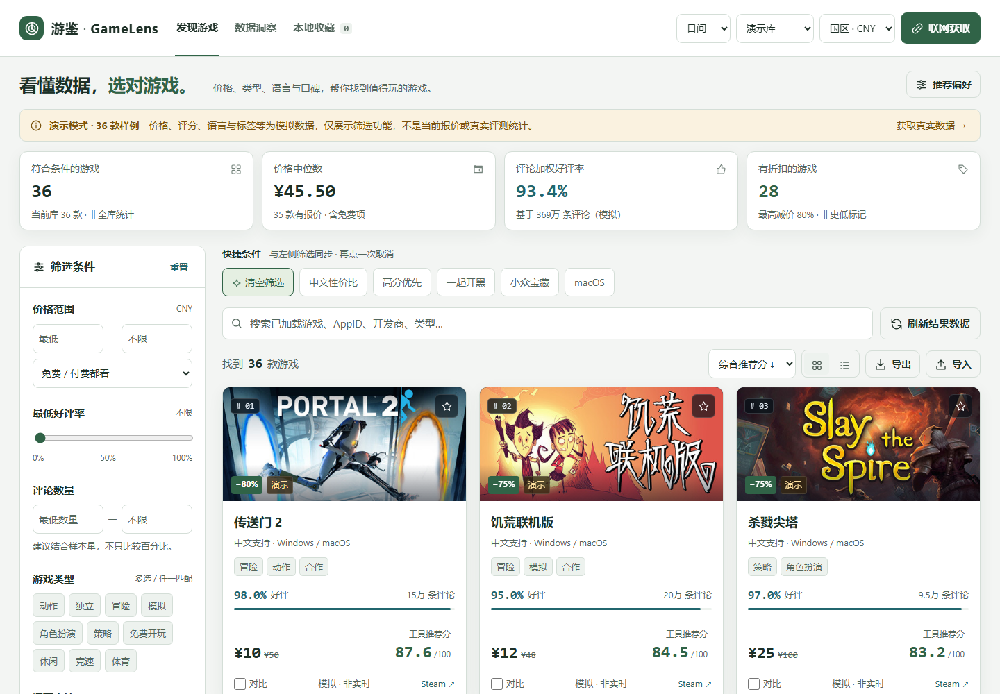

# 游鉴 · GameLens

**看懂数据，选对游戏。**

一款面向 Steam 玩家的游戏发现与决策工具，通过价格、类型、语言和口碑等多维数据，帮助你找到值得玩的游戏。



## 功能

- 按价格、类型、语言与配音、口碑、平台和玩法筛选游戏，支持多种排序。
- 综合口碑、预算、折扣和中文支持计算推荐分，可调整权重、查看计算依据。
- 一键获取热销、特价和新发行候选，也可输入游戏名称、AppID 或 Steam 商店链接。
- 宽版详情、分栏配置、最多 4 款横向对比、统计图表和本地收藏。
- 日间、傍晚、夜晚三套主题，适配桌面与手机；支持 JSON 导入导出及 CSV 导出。

## 快速开始

### 离线体验

下载项目后直接打开 `steam_lens.html`，即可使用内置样例或导入自己的数据。无需安装前端依赖；加载 Steam 封面仍需要网络。

**36 款内置样例的价格、评价、语言、平台等为模拟数据，不是实时行情。** 演示库、采集库、导入库分开保存。统计仅覆盖当前加载并筛选的游戏。

### 获取真实 Steam 数据

需要 **Python 3.10+**，运行时仅使用标准库。

- **Windows**：双击 `start_windows.bat`。
- **macOS / Linux**：在项目目录运行 `python3 server.py`。

浏览器打开 [本机页面](http://127.0.0.1:8765/)，点击 **联网获取 → 一键获取热销游戏**。也可粘贴名称或链接后回车。采集支持停止及重试，成功条目会保留。

本机服务只监听 `127.0.0.1`，不需要 Steam 账号、Cookie 或 API Key。上游不可用或限流时会显示错误；健康检查成功不等于 Steam 已连通。

## 开发与验证

前端源码为 `app.js` 和 `ui.template.html`。修改后重新构建单文件 HTML：

```bash
python build.py
python server.py --no-browser
```

开发检查需要 Node（JS 语法检查）与 Playwright / Chromium（浏览器测试）；应用本身不需要它们：

```bash
python -m pip install playwright
python -m playwright install chromium
python .agents/skills/steam-lens-maintainer/scripts/run_checks.py --root . --browser
python test_usability.py
```

构建不会联网；样例的官方封面地址来自 `demo_cover_metadata.json`。`steam_lens.html`、`steam-lens.v1` 存储键和现有数据格式保留，用于兼容早期 Steam Lens 版本。

## 更多说明

- [完整中文使用说明](README_中文.md)
- [v1.2 修复与验证记录](TEST_REPORT_v1.2.md)
- [项目维护说明](AGENTS.md)

收藏、主题、导入和采集记录保存在当前浏览器；切换浏览器或访问地址时不会自动迁移，建议导出 JSON 备份。价格以对应地区 Steam 结算页面为准。

采用 [MIT License](LICENSE)。本项目非 Valve 官方产品；许可证不授予 Steam 商标、游戏名称或第三方封面作品的权利。
